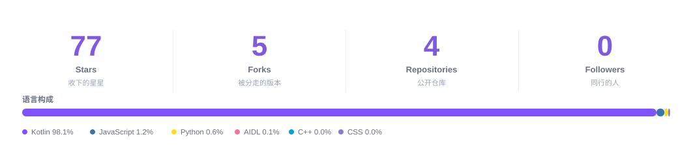
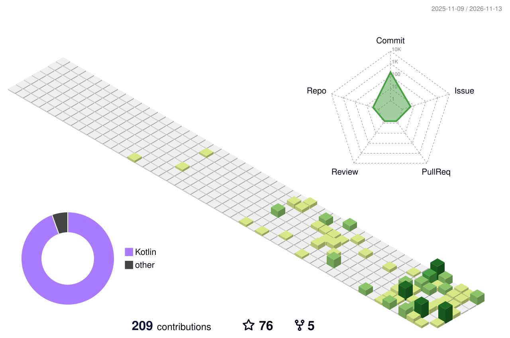

<!--
  GitHub Profile README · oneroomlife
  版式参考 https://github.com/BEPb（BEPb/BEPb），视觉资产全部自制、随仓库分发：
    assets/header.svg               渐变波浪横幅（四层无缝位移波浪 + 上浮气泡，SMIL 动画）
    assets/divider.svg              章节分隔波纹
    assets/footer.svg               页脚（心形呼吸 + 波浪 + 气泡）
    assets/bilibili.svg             B 站跳转按钮
    assets/projects-graph.svg       项目关系图
    assets/contribution-graph*.svg  贡献热力图（scripts/gen_assets.py 生成，每日自动刷新）
    assets/stats*.svg               数据面板（同上）
  页面不依赖任何第三方图片服务，只保留 shields / typing / streak / getloli / star-history 这类长期稳定的接口。
    assets/header.svg               渐变波浪横幅（SMIL 动画）
    assets/divider.svg              章节分隔波纹
    assets/footer.svg               页脚
    assets/bilibili.svg             B 站跳转按钮
    assets/contribution-graph*.svg  贡献热力图（scripts/gen_assets.py 生成，每日自动刷新）
    assets/stats*.svg               数据面板（同上）
  页面不依赖任何第三方图片服务，只保留 shields / typing / streak / getloli / star-history 这类长期稳定的接口。
-->

  

  
  
  
  
  
  
  

  

## 📈 贡献热力图

<picture>
  <source media="(prefers-color-scheme: dark)" srcset="https://raw.githubusercontent.com/oneroomlife/oneroomlife/main/assets/contribution-graph-dark.svg" />
  <source media="(prefers-color-scheme: light)" srcset="https://raw.githubusercontent.com/oneroomlife/oneroomlife/main/assets/contribution-graph.svg" />
  
</picture>

<picture>
  <source media="(prefers-color-scheme: dark)" srcset="https://raw.githubusercontent.com/oneroomlife/oneroomlife/main/assets/stats-dark.svg" />
  <source media="(prefers-color-scheme: light)" srcset="https://raw.githubusercontent.com/oneroomlife/oneroomlife/main/assets/stats.svg" />
  
</picture>

  

## 🐍 摸鱼蛇 & 🧊 3D 贡献图

  <picture>
    <source media="(prefers-color-scheme: dark)" srcset="https://raw.githubusercontent.com/oneroomlife/oneroomlife/output/github-snake-dark.svg" />
    <source media="(prefers-color-scheme: light)" srcset="https://raw.githubusercontent.com/oneroomlife/oneroomlife/output/github-snake.svg" />
    
  </picture>

  

## 📺 在 B 站找我

  
    
  
  
  

### Profile Views

counting of visitors to this page in this section started from 2026-11-11

  

## ⭐ Star History

  

